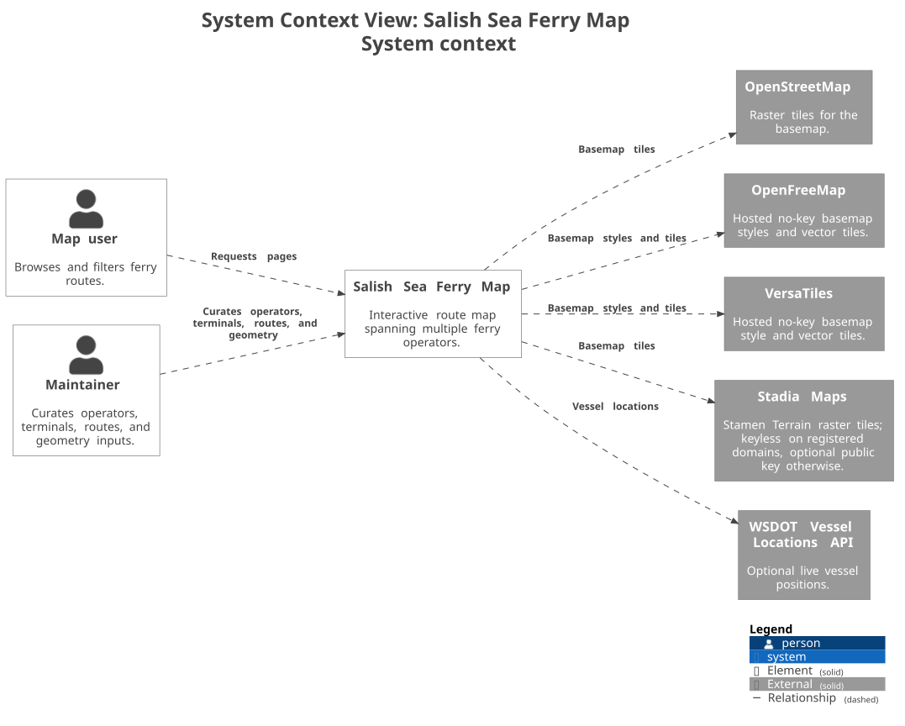
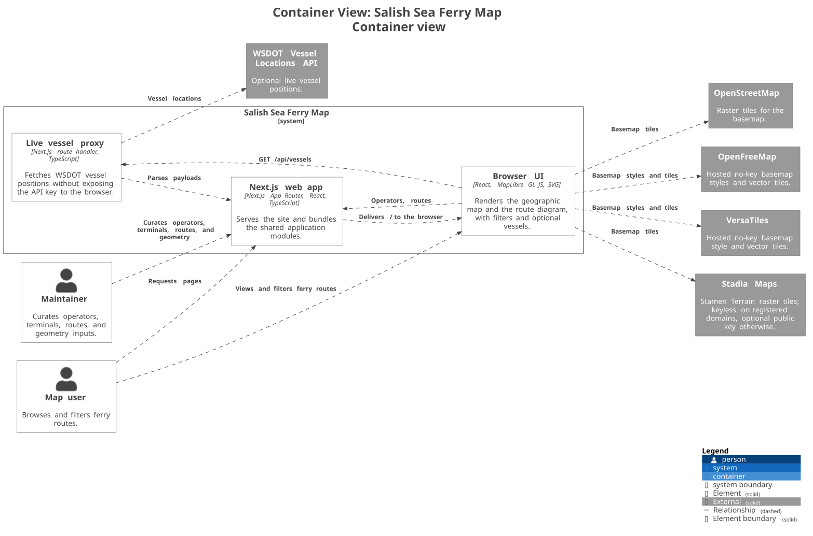
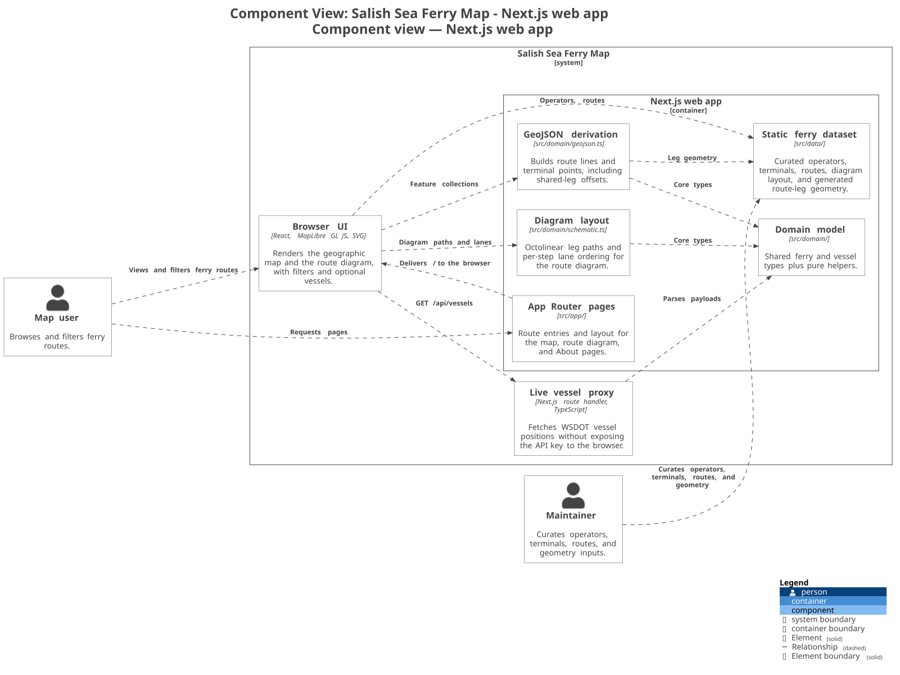
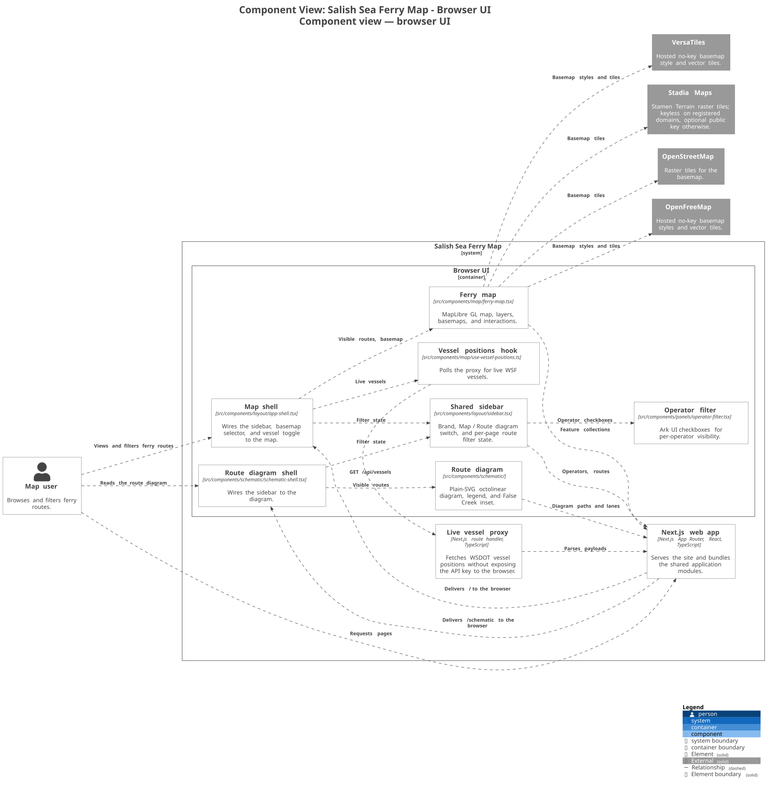
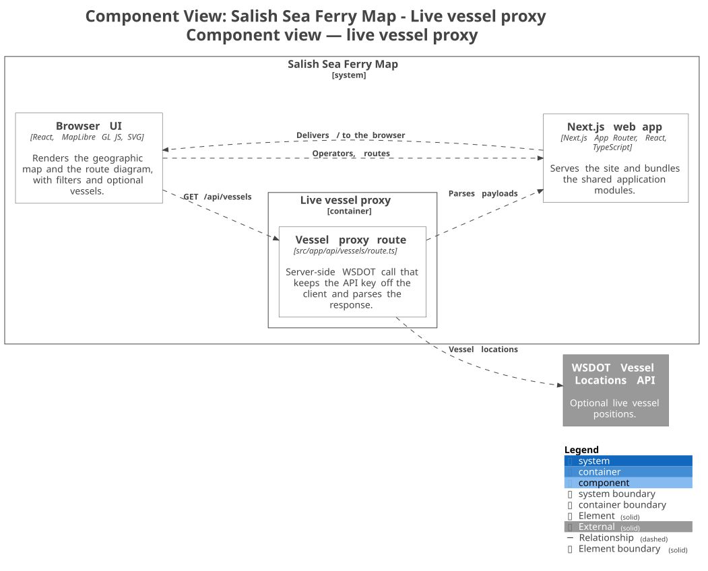

# Architecture overview

This project is a small, static-first map of ferry routes across the Salish Sea.
The core model stays deliberately narrow:

- `Terminal` is a point
- `FerryRoute` is an ordered list of terminal ids sailed by one operator
- map styling, filtering, GeoJSON, and the route diagram are derived from that dataset

That keeps most change in `src/data/` and `src/domain/` instead of spreading
route knowledge across UI code.

## C4 views

Following the [C4 model](https://c4model.com/), zooming in one level at a time.
The source of truth is [`workspace.dsl`](./workspace.dsl); everything below is
generated from it, so the levels cannot disagree with each other.

| Level | View | Scope |
| --- | --- | --- |
| 1 | [System context](./generated/plantuml/structurizr-system-context.svg) | Map user, maintainer, the map itself, and its external dependencies |
| 2 | [Container view](./generated/plantuml/structurizr-container-view.svg) | The Next.js app, the browser UI, and the live vessel proxy |
| 3 | [Component view — Next.js web app](./generated/plantuml/structurizr-component-view-web-app.svg) | Page entry points plus the shared dataset, domain, GeoJSON, and diagram-layout modules |
| 3 | [Component view — browser UI](./generated/plantuml/structurizr-component-view-browser-map.svg) | The map and route-diagram shells, shared sidebar, operator filter, map, diagram, and live-vessel polling |
| 3 | [Component view — live vessel proxy](./generated/plantuml/structurizr-component-view-vessel-proxy.svg) | The server-side route that fetches WSDOT vessel positions |

### Level 1 — System context



The map, the people who use and maintain it, and the external systems it
depends on: four hosted basemap providers ([ADR 0007](../adr/0007-selectable-no-key-basemaps.md))
and the WSDOT vessel API.

### Level 2 — Containers



Three runtime pieces: the Next.js app that serves the site, the browser UI it
delivers (the MapLibre map at `/` and the SVG route diagram at `/schematic`),
and the live vessel proxy the browser calls for optional WSF positions.

### Level 3 — Components







Level 4 (code) is deliberately omitted — the type definitions in `src/domain/`
already serve that purpose and would only go stale if duplicated here.

### Where things live, and why

A [C4 container](https://c4model.com/abstractions/container) is "a runtime
boundary around some code that is being executed or some data that is being
stored". Two placements follow from that and are easy to get wrong:

- The **curated dataset** is a component, not a container. It compiles into the
  application bundle and starts nothing.
- The **live vessel proxy** is a container in the runtime view because the
  browser calls a distinct server-side boundary for WSDOT data; at level 3,
  that boundary has a single `Vessel proxy route` component.

The current runtime split is narrower than the directory layout suggests:
`src/domain/geojson.ts` is called from `FerryMap` in the browser, the proxy
parses WSDOT responses server-side, and route-leg geometry is pre-generated at
build time.

`src/domain/mesh.ts` appears in no view at all: it is reached only by
`scripts/build-route-geometry.ts` at build time, and by
`scripts/gtfs-validation.ts` in tests. See
[Build-time and maintainer scripts](#build-time-and-maintainer-scripts).

The route diagram's drawing constants live in
`src/components/schematic/schematic-geometry.ts`, which the on-screen diagram
and the print-file script both import
([ADR 0008](../adr/0008-print-files-from-diagram-code.md)). Only the
on-screen use is a runtime relationship, so only that one is in the model.

Relationships are declared once in the DSL, at the most specific level that is
true, and Structurizr implies the container- and system-level edges from them.
That is why the container view says the browser UI requests basemap tiles
and the component view attributes it to the `Ferry map` component — the same
statement, shown at two zoom levels, rather than two claims that can drift apart.

### Regenerating diagrams from the DSL

Edit `workspace.dsl`, then regenerate deliberately — this is not part of
`npm run build` or Netlify deploys. Both tools are pinned, and Docker is used so
that no local Java install is required:

```bash
# from the repository root
rm -rf docs/architecture/generated/plantuml
mkdir -p docs/architecture/generated/plantuml

docker run --rm --user "$(id -u):$(id -g)" -v "$PWD":/work -w /work structurizr/cli:2025.11.09 \
  export -workspace docs/architecture/workspace.dsl \
  -format plantuml/c4plantuml \
  -output docs/architecture/generated/plantuml

docker run --rm --user "$(id -u):$(id -g)" -v "$PWD":/work -w /work plantuml/plantuml:1.2026.8 \
  -tsvg docs/architecture/generated/plantuml/*.puml

perl -0pi -e 's/<\?plantuml [^?]+\?>//g' docs/architecture/generated/plantuml/*.svg
```

The final pass removes PlantUML's processing instruction so the committed SVGs
render inline on GitHub.

Commit the regenerated `.puml` and `.svg` files alongside the DSL change.

## Key runtime pieces

- `src/data/{operators,terminals,routes}.ts` — the hand-curated source of truth
- `src/data/schematic-layout.ts` — hand-placed grid positions, land, and insets for the route diagram
- `src/domain/geojson.ts` — derives map-ready GeoJSON, including shared-leg offsets
- `src/domain/schematic.ts` — octolinear leg paths and lane ordering for the route diagram
- `src/components/map/ferry-map.tsx` — renders the MapLibre map in the browser
- `src/components/map/basemaps.ts` — the registry of selectable basemaps
- `src/components/schematic/` — renders the route diagram as plain SVG
- `src/components/layout/sidebar.tsx` — sidebar and filter state shared by both pages
- `src/app/api/vessels/route.ts` — optional server-side proxy for WSDOT live vessels
- `src/app/about/page.tsx` — data sources and credits

The web app also serves talk decks at `/talks/<slug>` as static files staged
into `public/` at build time
([ADR 0009](../adr/0009-talk-decks-as-staged-static-files.md)). They don't use
application code and are outside the C4 model.

## Build-time and maintainer scripts

None of these run in the browser or the server, so the C4 views leave them
out. Most of them import `src/data/` and `src/domain/` directly under plain
Node, so those modules have to stay free of runtime `@/` imports.

| Script | npm script | What it does |
| --- | --- | --- |
| `scripts/build-route-geometry.ts` | `build-route-geometry` | Regenerates `src/data/route-leg-geometry.ts` from the OSM snapshot and water mesh |
| `scripts/build-gtfs.py` | `build-gtfs`, `refresh-gtfs`, `check-gtfs` | Fetches, pins, and checks GTFS archives; writes `src/data/generated/gtfs.ts` ([ADR 0005](../adr/0005-gtfs-as-build-time-input.md)) |
| `scripts/gtfs-validation.ts` | via `npm test` | Compares curated routes and terminals with the pinned feeds |
| `scripts/export-print-files.ts` | `print-files` | Draws the route diagram as Printful PNGs and SVGs ([ADR 0008](../adr/0008-print-files-from-diagram-code.md)) |
| `scripts/export-routes.ts` | `export:routes` | Writes the vendored OSM ferry routes as GeoJSON, with ODbL metadata |
| `scripts/copy-maplibre-worker.mjs` | `maplibre-worker` | Stages the MapLibre worker into `public/` |
| `scripts/copy-talks.mjs` | `talks` | Stages talk decks into `public/` ([ADR 0009](../adr/0009-talk-decks-as-staged-static-files.md)) |
| `scripts/generate-favicons.mjs` | `favicons` | Rasterizes the favicon set from the brand mark |

## Deployment and verification

- Production builds on Netlify with `@netlify/plugin-nextjs` (`netlify.toml`).
  `next.config.ts` also sets `output: "standalone"`, which the `Dockerfile`
  and `docker-compose.yml` package as a self-contained Node image.
- CI (`.github/workflows/ci.yml`) checks the pinned GTFS, typechecks, lints,
  runs Vitest with coverage, then builds and runs the Playwright smoke tests
  in `e2e/`.

## Data and geometry flow

1. Operators, terminals, and routes are maintained as readonly TypeScript data.
2. Build-time route-leg geometry prefers vendored OSM ferry routes, then mesh
   paths through navigable water, then straight lines as a final fallback.
   This runs in `scripts/build-route-geometry.ts`, which is why `src/domain/mesh.ts`
   appears in no runtime view — it is only reached at build time.
3. Pinned GTFS feeds are checked against the curated records in tests; they
   never feed the running site ([ADR 0005](../adr/0005-gtfs-as-build-time-input.md)).
4. The client map consumes the derived GeoJSON and draws routes, terminals, and
   optional live WSF vessels on top of the selected basemap.
5. The route diagram reads the same records plus `schematic-layout.ts` and
   draws them as SVG, with no basemap.

## Scope boundaries

- This is a **route map, not a trip planner**: schedules and fares stay out of scope.
- This is **not for navigation**: dock-level coordinates and route geometry are
  mapping aids, not charted tracks.

## Notes on the ADRs

ADRs 0001–0004 and 0007–0009 in [`../adr/`](../adr/) were reconstructed
after the fact, from the README, source layout, issues, and pull requests.
ADRs 0005 and 0006 were written as the decisions were made. The
[decision log](../adl/) records when each one changed state.
